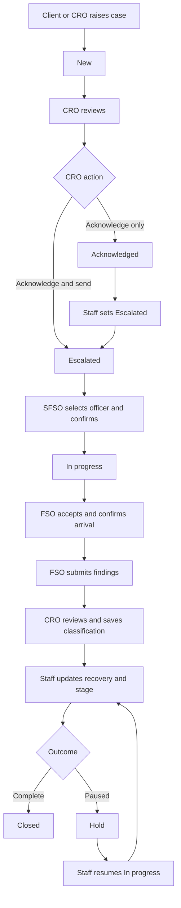

# Mohafiz Case Desk: Role and Dashboard Guide

This document describes the current browser application. Use the suggested operational flow for process diagrams; the implementation notes identify where the demo permits a different sequence. Role abbreviations follow the application's labels.

## 1. Roles and access

| Role | Demo identity | Landing dashboard | Case visibility | Responsibility |
| --- | --- | --- | --- | --- |
| CRO | Shoaib | Today | All companies | Intake, acknowledgement, escalation, communication, classification, tracking and reporting |
| SFSO | Ahmed | Escalations | All companies | Officer assignment, workload monitoring, case supervision and communication |
| FSO | Ali Raza | My Cases | Cases assigned to Ali Raza | Acceptance, arrival confirmation, field findings and internal updates |
| Client | Selected company user | My Cases | Selected company only | Raise incidents, track progress, communicate and export reports |

Client options are PostEx, Daraz and Buscaro. Company is selected through the sign-in role dropdown.

## 2. Common sign-in and navigation

1. Enter an email in valid email format and a nonempty password.
2. Select CRO, SFSO, FSO or a client company.
3. Use Show/Hide to toggle password visibility if needed.
4. Sign in to open the role's landing dashboard.
5. Use the sidebar to navigate and the sign-out button to switch roles.

The email does not determine identity or permissions in this demo; the selected role does. Forgot password displays a simulated reset notice. Signing out retains session data in the current page; refreshing resets it. Staff headers show user and role, with a light/dark theme toggle whose preference persists locally.

## 3. CRO dashboard and workflow

### Today

The CRO starts here. It provides:

| Dashboard item | Meaning | Opens |
| --- | --- | --- |
| To acknowledge | Cases with New status | New Cases |
| Updates to review | Messages by other users across conversations | Client Updates |
| On hold | Cases with Hold status | Case Board |
| Open cases | Every case except Closed | Case Board |
| Your next action | Prompt to acknowledge incoming cases | New Cases |
| Recent activity | Latest six session audit entries | Display only |

Updates to review is a message count, not an unread-message tracker. Opening a conversation does not clear it.

### New Cases

Displays only New cases. Filter by company, city and priority, then open the Case ID to inspect details.

- **Acknowledge only:** changes New to Acknowledged; it does not send the case to the SFSO escalation queue.
- **Acknowledge & send to SFSO:** changes New directly to Escalated and proposes Ali Raza as officer.
- **Log a case:** creates a case on a client's behalf.

CRO intake requires company, issue, city, nonnegative amount, priority, address, source channel and a description of at least 20 characters. Source options are Phone, Email and Client portal. Submission generates a reference, sets New status and returns to New Cases.

### Case Board and case details

The board groups every company case into New, Acknowledged, Escalated, In progress, Hold and Closed. Each column shows its case count. Open a card to inspect the case.

Case details show company, city, issue, description, stage, amount, recovered amount, officer, classification, saved initial remarks and field report when available.

CRO can change Stage and Recovered (PKR). Recovery must be between zero and the case amount. Stage and recovery edits save immediately. Open conversation goes to Client Updates for the selected case.

An Acknowledged case can be sent onward by changing its Stage to Escalated in case details. There is no separate send button on the board and no drag-and-drop stage movement.

### Client Updates

Select a case to exchange messages with the client and SFSO. Text and Document, Image, Video or File attachments are available. Only attachment names are stored.

### Internal Case Group

Select a case for staff discussion with SFSO and the assigned FSO. This conversation is separate from Client Updates and absent from client navigation. Field reports are posted here automatically when submitted.

### Classification / Classify Incidents

The screen shows every case whose status is not New, including previously classified and Closed cases.

Columns: Case, Date, Victim / Accused, Incident, Region / Branch, Amount, Current TAT, Classification, Initial Remarks and Action.

1. Review the incident and use Open detail if needed.
2. Select Genuine, Negligence or Fraud.
3. Enter initial remarks if required by the operation; the application does not require remarks.
4. Click that row's Submit to save classification and remarks together.
5. View classification in Reports and remarks in case details.

Track Incidents opens Case Board. Saving classification does not close the case. Reviewing an FSO report first is the suggested process, but the application does not enforce it. Victim and TAT show Not recorded / Not set when absent, and branch falls back to company. Current intake does not collect victim, branch or TAT, and there is no TAT timer or calculation.

### Reports

CRO can report on all companies. Filter by company, city, date range, status, classification and partial Case ID. The displayed case count, total amount and recovered amount use the filtered records. Reset clears filters. Export CSV downloads those same records.

Report columns: Case ID, Raised By, Date Reported, Incident Type, Classification, Total Amount, Recovered, City and Status. Raised By currently represents the company.

### Audit Logs

Displays session user, action, Case ID and time. Sign-ins, sign-outs, navigation, case creation and changes, messages and exports generate entries. No edit or delete control is provided. These records are held in browser memory and are not a permanent audit store.

### CRO process outline

Login -> Today -> Review New Cases -> Acknowledge or escalate -> Monitor assignment and field findings -> Communicate -> Classify and save remarks -> Update recovery and stage -> Close -> Review/export reports.

## 4. SFSO dashboard and workflow

### Escalations

This is the SFSO landing dashboard. It lists only Escalated cases with case reference, company, issue, city, priority, status and assignment actions.

1. Review the escalated case or open its details.
2. Keep the proposed officer or select Ali Raza, Ahmed Khan or Sara Ahmed.
3. Click Confirm assignment.
4. The case changes to In progress and leaves the escalation queue.

Changing the officer selection saves the officer immediately; Confirm assignment changes the stage. There is no separate officer-acceptance status in this queue.

### Case Board

Shows all companies and the same six stages as CRO. SFSO can open case details, change the stage, update recovery, place a case on Hold, resume it by setting In progress, or close it. These edits save immediately.

### Client Updates and Internal Case Group

Client Updates supports external case communication with the client and CRO. Internal Case Group supports staff discussion and field-report review. Both use a case selector and separate message histories.

### Field Team

Shows each demo officer, a fixed display city, active-case count and Hold count. Active means every assigned case except Closed, so Hold cases are included in active counts as well as shown separately. The city column is a demo officer mapping, not live location.

SFSO has no Classification, Reports, Audit Logs or case-intake page in its navigation.

### SFSO process outline

Login -> Escalations -> Review -> Select officer -> Confirm assignment -> Monitor Case Board and Field Team -> Review field updates -> Communicate -> Update stage/recovery or close as appropriate.

## 5. FSO dashboard and workflow

### My Cases

The landing dashboard uses a compact field-work layout. It shows only cases assigned to the demo identity Ali Raza, across companies.

Each case shows its reference, company, issue, city and stage. Non-Closed cases provide:

| Action | Requirement | Result |
| --- | --- | --- |
| Accept case | Not already accepted | Saves acceptance and sets In progress; records simulated tracking start |
| Confirm arrival | Case accepted and arrival not already confirmed | Saves simulated arrival confirmation |
| Send report | Arrival confirmed and findings at least 20 characters | Saves report and adds it to the internal conversation |

Photos or voice notes can be selected as evidence; only filenames are retained. Sending a report does not automatically classify or close the case. A later report can be submitted again: the latest replaces the report in case details, while each submission adds an internal conversation message.

Closed cases remain visible when assigned to the FSO, but their acceptance, arrival and report controls are hidden. Open case group remains available.

### Case Group

An internal conversation for the FSO's assigned cases. Select a case, send text or attach a filename. The FSO cannot access Client Updates, other officers' cases, reports, classification or the staff Case Board through navigation.

### FSO process outline

Login -> My Cases -> Accept case -> Confirm arrival -> Enter findings and optional evidence -> Send report -> Discuss in Case Group -> Staff reviews findings.

Implementation note: visibility currently checks the assigned officer, not SFSO confirmation. A case proposed to Ali Raza can appear before the supervisor confirms it. Accept case itself sets In progress. The demo therefore does not strictly enforce SFSO confirmation before FSO acceptance.

## 6. Client dashboard and workflow

The three client companies use the same screens, filtered to their selected company.

### My Cases

The landing dashboard shows counts for Open, Closed and Waiting for acknowledgement, followed by the company's case table. Open includes all cases except Closed; Waiting for acknowledgement counts New cases.

The table shows Case ID, company, issue, city, priority, stage and a plain-language handling message. Open a Case ID to inspect details. Clients can read case information, including saved classification, remarks and any field report shown in details, but cannot edit stage or recovery. Open conversation opens Client Updates.

### Raise a Case

1. Choose issue type and city.
2. Enter a nonnegative amount and choose priority.
3. Enter address and description of at least 20 characters.
4. Click Send case.
5. Receive a generated reference and return to My Cases with status New.

Company comes from login; clients have no separate company or source-channel selector. Current cities are Karachi, Lahore and Islamabad. Issue choices include Customer Issue, Payment dispute, Verification issue, Service complaint, Fake Delivery, Snatching and Theft.

### Client Updates

Select one of the company's cases and exchange text or attachment filenames with CRO and SFSO. Other companies and internal staff conversations are unavailable in this navigation.

### Reports

Filter the company's records by city, date range, stage, classification or Case ID. View filtered totals and export matching rows as CSV. Clients cannot change the report company.

### Client process outline

Login with company -> My Cases -> Raise a Case -> Receive reference -> Track acknowledgement and investigation -> Exchange Client Updates -> View outcome -> Filter/export Reports.

## 7. Shared case lifecycle and handoffs

| Stage | Typical meaning | Current action that sets it |
| --- | --- | --- |
| New | Received, awaiting CRO review | Client or CRO submits intake |
| Acknowledged | CRO has received/reviewed the case | CRO selects Acknowledge only |
| Escalated | Waiting for supervisor assignment confirmation | CRO selects Acknowledge & send, or staff changes Stage |
| In progress | Assigned/being worked | SFSO confirms assignment, FSO accepts, or staff changes Stage |
| Hold | Work temporarily paused | CRO/SFSO changes Stage |
| Closed | Staff marks work complete | CRO/SFSO changes Stage |

Classification is a separate field from stage. Genuine, Negligence and Fraud do not represent workflow stages. Recovery is also independent; closure does not require full recovery.

Suggested operational handoffs:

For flowcharts, represent the following as enforced checks: valid intake fields, required classification selection, acceptance before arrival, arrival before report, minimum findings length, and recovery within case amount. The general stage dropdown permits any listed stage, including reopening Closed cases; strict sequential transitions, classification before closure and mandatory recovery before closure are not enforced. Hold does not disable existing FSO controls.

## 8. Current demo boundaries

- Cases, messages, assignments, reports and logs live in the current page's memory. Refresh resets them to demo records. Separate browser tabs or users do not share updates.
- Sign-out/sign-in role switching in the same page is the supported way to demonstrate handoffs. This is not a production authentication or server authorization system.
- No real GPS, notifications, password reset, file upload/download storage or backend is connected.
- Demo case dates and newly created case dates are fixed to 28 October 2026; date filters operate on those stored dates.
- Officer identity and displayed officer cities are fixed demo values. Only Ali Raza has an FSO login option.
- Classification does not automatically close a case; reports and dashboards recalculate from current session records.
- There is no separate administrator dashboard, approval workflow, unread-message tracking, TAT calculation or automatic SLA escalation.
